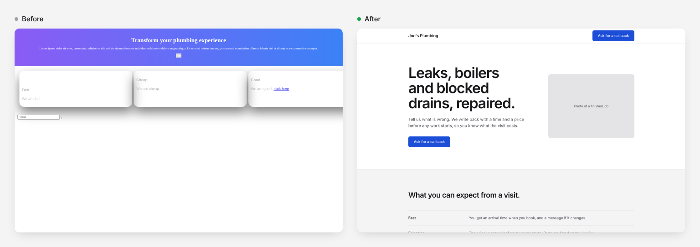

# UI/UX Glowup — Skill d'agent

[English](README.md) · **Français**



Score d'audit de cette page, mesuré avec `scripts/audit.mjs` : **27/45 avant → 45/45 après** (`tests/fixtures/before.html` et `tests/fixtures/after.html`).

Un skill d'agent IA qui amène n'importe quelle interface web au niveau des sites les mieux conçus du web : Linear, Stripe, Vercel, Apple, Airbnb, Mercury et d'autres. Il fonctionne avec Claude Code, OpenAI Codex, Cursor, Windsurf, GitHub Copilot et tout agent compatible avec la [spécification Agent Skills](https://agentskills.io).

Il **garde les couleurs de votre marque** et travaille tout le reste : structure, typographie, espacements, composants et finitions. Sans marque existante, il propose une palette courte à confirmer, jamais une identité de marque. Ensuite il **regarde son propre résultat** avec des captures d'écran ordinateur et mobile, et corrige ce qu'il voit.

**Les contributions sont les bienvenues !** Une idée pour améliorer le skill ou un nouvel exemple à ajouter ? [Ouvrez une PR](#contribuer).

## Ce qui le rend différent

- **Il commence par un court questionnaire.** En partant de zéro ou pour une refonte : type de projet (SaaS/tech, portfolio/agence, site vitrine, e-commerce, tableau de bord), objectif, **niveau de modernité** (Classique / Moderne / Audacieux), visuels, icônes, mode sombre, graphiques, éléments à conserver, choix de marque à garder, expressions SEO. Les réponses deviennent un brief.
- **Il finit toujours par un récap « Directions taken ».** Style, références et ce qui leur est emprunté, typographie, composants, icônes, graphiques/KPI, corrections mobile, SEO, chaque modification de texte avant → après, décisions produit à confirmer.

- **Des références nommées, pas de vagues bonnes pratiques.** Pour chaque travail, l'agent choisit 2 ou 3 sites de référence de la même catégorie et dit exactement ce qu'il emprunte à chacun.
- **Du code d'exemple testé.** 15 pages et sections complètes (dont un kit de KPI et de graphiques clair/sombre) en Tailwind v4, plus un tableau de bord React typé. L'agent part de ces exemples, donc le niveau de départ est élevé.
- **Une vérification visuelle.** Un script Playwright capture le résultat à 1440 px et à 390 px et signale tout débordement horizontal. L'agent relit, corrige et capture à nouveau.
- **Mesuré, pas estimé à l'œil.** `audit.mjs` contrôle le contraste, les zones tactiles, l'échelle typographique, la grille d'espacement, les titres, les labels et plus encore, sur ordinateur et sur mobile, et note 9 critères (/45, SEO compris) avant et après. Rien n'est livré sous 4/5.
- **Il attrape les vrais bugs sur téléphone.** Les montants et les libellés de boutons qui passent à la ligne, les colonnes de tableau poussées hors de l'écran, le contenu coupé, les zones tactiles trop serrées, les champs qui font zoomer iOS, le zoom bloqué, les bandeaux qui couvrent l'écran, les carrousels sans aimantation ou avec des flèches minuscules ou sans nom. Il nomme aussi les causes racines (par exemple une taille de police racine de 15 px derrière des centaines d'espacements fractionnaires).
- **Espacements, lisibilité et SEO.** Écarts entre les blocs et rythme des sections, paragraphes et phrases trop longs, texte justifié, title/description/Open Graph/favicon/canonical/JSON-LD, format, taille et chargement différé des images. Les textes sont clarifiés pour les lecteurs, jamais réécrits pour y glisser des mots-clés.
- **Lisible par les robots et les assistants IA.** L'audit charge la page une fois de plus sans JavaScript et signale un H1 absent, du texte absent ou une FAQ absente ; un H1 dont les mots sont collés dans le HTML ; un JSON-LD illisible, d'un type inconnu, différent de la FAQ visible ou portant une note sans avis. `audit-site.mjs` ajoute `robots.txt`, `sitemap.xml`, `llms.txt`, les robots IA bloqués et les hreflang.
- **Des animations qui ne cachent jamais le contenu.** Texte resté invisible quand l'animation ne se joue pas (sans JS, mouvement réduit), propriétés de mise en page animées, décalages de mise en page au défilement, apparitions sur toutes les sections, boucles infinies, animations lentes et `will-change` partout.
- **Des textes honnêtes.** Les appels à l'action vagues (« Learn more », « En savoir plus »), les clichés en anglais et en français, les affirmations sans source (« n°1 », « +500 clients ») et les messages d'erreur génériques sont signalés. Le skill n'invente jamais un chiffre, une note ou un avis.
- **Le bon registre selon le secteur.** `sectors.md` couvre santé, services publics, finance, immobilier, voyage, éducation, mode, médias et plus, avec un contrôle de variété face au look tech par défaut.
- **Marque conservée.** `brand-guard.mjs` échoue quand un changement retire une couleur de marque, abandonne une police ou ajoute une bibliothèque UI non demandée.
- **Toutes les tailles, toutes les langues.** `responsive.mjs` balaie 14 tailles et teste mots longs, +50 % de texte et droite-à-gauche ; `consistency.mjs` vérifie que les pages forment un seul site.
- **Atteignable même sans souris.** Les parcours fixent un objectif et un budget d'actions et peuvent tourner au clavier seul ; `ux.mjs` ajoute les contrôles de chaque type de site (boutique, SaaS, commerce local, tableau de bord, article) classés par impact ; `a11y.mjs` manipule onglets, accordéons, modales et menus et teste le zoom à 200 % et 400 %.
- **Mesuré, pas seulement affirmé.** `benchmark/` injecte des défauts et des régressions connus dans dix projets et publie ce qui est trouvé, manqué et signalé à tort sur des pages propres (`docs/benchmark.md`).
- **Sans danger à lancer.** Les sauvegardes excluent `.env` et les sessions, les sorties masquent les jetons, un hook pre-commit bloque les secrets, et `doctor.mjs` dit ce qui manque et comment le corriger.
- **Votre stack, conservée.** `stack.mjs` détecte Next, Nuxt, Vue, Svelte, Angular, Astro, WordPress (et son constructeur), Tailwind, shadcn, MUI, Bootstrap et indique où vivent les tokens ; rien de nouveau n'est ajouté sans demander.
- **Tous les navigateurs.** `cross-browser.mjs` compare Chromium, Firefox et WebKit ; `--browser` fonctionne sur les autres scripts.
- **Rapide.** `perf.mjs` mesure LCP, CLS, temps de blocage et poids sur un téléphone bridé, et nomme la cause : image principale surdimensionnée ou en lazy, scripts bloquants, polices, bibliothèques lourdes.
- **Accessible au clavier.** `a11y.mjs` parcourt la page avec Tab et vérifie focus, ARIA, liens d'évitement et reflow à 320 px selon WCAG 2.2 AA.
- **Rien n'est cassé.** `smoke.mjs` clique chaque contrôle sans risque, vérifie formulaires et erreurs JS, et `--baseline` signale ce qu'une refonte a cessé de faire.
- **Rien n'est oublié.** `inventory.mjs` liste chaque élément d'une page (liens, appels à l'action, formulaires, images, contacts, mentions légales, traceurs, données structurées) et `--compare` montre ce qu'une refonte a perdu.
- **Visuels, graphiques et KPI.** Des repères pour une 3D propre, des grilles bento avec micro-animations, le semi-flat, des graphiques SVG interactifs (Recharts, Chart.js, Framer Motion), des anneaux avec le chiffre clé au centre, des cartes KPI avec sparklines, le mode sombre pour chaque graphique, WebP/AVIF + SVG.
- **Des PDF propres.** Factures et devis (mentions légales françaises, réforme 2026 comprise), rapports, propositions et documents d'une page à partir de modèles prêts à imprimer. `pdf.mjs` imprime, puis contrôle les polices (intégrées, pas de Type 3 flou, pas de glyphes de remplacement), les pages vides ou presque vides, les débordements, le texte minuscule, le titre, les numéros de page et les mentions que chaque type de document exige, et montre toutes les pages dans une seule image. `site-fonts.mjs` réutilise les polices du site web, avec des indications de licence.
- **Icônes et favicons.** `find-icons.mjs` cherche parmi plus de 200 000 icônes ouvertes (Phosphor, Solar, Tabler…) avec leurs licences, plus Flaticon ; `make-favicon.mjs` génère toutes les tailles de favicon et le bloc `<head>`.
- **Il fonctionne sur de vrais produits.** Il audite les pages derrière une connexion, des sites entiers (`audit-site.mjs`), et relie chaque constat à un `fichier:ligne` de votre code (`locate.mjs`) pour que les corrections arrivent dans les vrais composants.
- **De vraies valeurs de référence.** `extract-tokens.mjs` mesure l'échelle typographique, l'interlettrage des titres, le rythme d'espacement, les rayons et les ombres d'un site de référence : « comme Linear » veut dire les vrais chiffres de Linear.
- **Anti « look IA ».** L'audit signale les indices mesurables (dégradés violets, verre dépoli partout, rayons géants, trois cartes identiques, emojis dans les titres, textes clichés, tout centré) ; `anti-ai.md` donne la correction pour chacun. Un motif que votre marque utilise exprès (une pastille au-dessus du titre, un mot accentué, des labels en majuscules) est listé au questionnaire et accepté avec `--allow`.

## Léger en tokens

- **Trois niveaux d'effort** — Quick (une correction), Standard (une page), Full (tout le site) : les petites demandes sautent le questionnaire, les références et l'inventaire.
- **Il ne charge que ce dont la tâche a besoin** : une table de routage dans `SKILL.md` pointe vers un fichier de référence par besoin, et les exemples se lisent section par section.
- **Des revérifications compactes** : `audit.mjs --baseline before.json` n'affiche que les changements de score et les problèmes ouverts (environ 70 % plus court qu'un rapport complet) ; `screenshot.mjs --selector ".pricing" --only mobile` ne capture que la partie modifiée.
- **Le chargement supplémentaire n'a lieu qu'une fois** : le rendu sans JavaScript se fait au premier audit ; les revérifications ne le refont que s'il a trouvé quelque chose (`--fast` le saute, `--deep` le force).

## Fonctionnement

```
  Questionnaire → brief ──► references/intake.md
  (refonte : inventaire)        scripts/inventory.mjs
          │
          ▼
  Audit automatique + revue visuelle ──► scripts/audit.mjs
          │
          ▼
  Choix de 2–3 sites de référence ──► references/sites.md
          │                            scripts/extract-tokens.mjs
          │
          ▼
  Reconstruction section par section ──► references/sections.md + craft.md
          │                      assets/examples/*.html
          ▼
  Captures ordinateur + mobile ──► scripts/screenshot.mjs
          │        ▲
          └ corr. ─┘
          │
          ▼
  Nouvel audit (≥ 4/5, aucune erreur) + inventory --compare
          │
          ▼
  Code + image avant/après + récap « Directions taken » ──► scripts/compare.mjs
```

## Exemples inclus

| Exemple | Inspiré de | Pour |
|---|---|---|
| `hero-linear.html` | Linear, Attio | SaaS, applications, outils |
| `bento-vercel.html` | Vercel, Apple | Fonctionnalités, services |
| `features-stripe.html` | Stripe | Explication produit, B2B |
| `pricing.html` | Linear, Vercel | Pages de tarifs |
| `dashboard-shell.html` | Linear, Stripe Dashboard | Back-offices, CRM, applications |
| `dashboard-dark.html` | Application Linear, Stripe, Vercel | Applications sombres et denses en données |
| `local-business.html` | Aesop, Mercury, Stripe | Artisans, services locaux, santé |
| `product-page.html` | Aesop, Allbirds | E-commerce |
| `kpi-cards.html` | Stripe, Linear, Vercel | Cartes KPI, anneau, jauge d'objectif, barres, sparklines — clair/sombre |
| `article.html` | Stripe Press, Linear Method | Blog, documentation, études de cas, actualités |
| `auth.html` | Linear, Vercel, Clerk | Connexion, inscription, étape d'accueil |
| `settings.html` | Linear, Stripe, GitHub | Écrans de compte, d'espace de travail, d'administration |
| `clinic.html` | Zocdoc, One Medical, NHS | Cabinets, santé, soins |
| `data-table.html` | GitHub, Stripe, Linear (listes) | Listes d'administration sobres : recherche, filtre, tri, actions groupées, état vide |
| `smb-light.html` | Sites B2B clairs et chaleureux | Logiciels pour PME, services B2B |
| `react/DashboardShell.tsx` | — | Projets React |

Modèles PDF (`assets/pdf/`) : `facture-devis.html` (facture/devis français), `report.html`, `proposal.html`, `one-pager.html`, `cv.html`, `letter.html`.

## Installation

### Option 1 : installation en ligne de commande (recommandée)

Avec [npx skills](https://github.com/vercel-labs/skills) :

```bash
npx skills add tpvn99/ui-ux-glowup
```

L'outil détecte les agents installés et demande où installer. Pour Claude Code, il installe dans `.claude/skills/` ; les agents universels partagent `.agents/skills/`.

> [!TIP]
> Si vous lancez la commande **depuis** une session d'agent, indiquez l'agent pour que le skill arrive là où votre agent le lit :
>
> ```bash
> npx skills add tpvn99/ui-ux-glowup -a claude-code
> ```

### Option 2 : plugin Claude Code

```bash
/plugin marketplace add tpvn99/ui-ux-glowup
/plugin install ui-ux-glowup
```

### Option 3 : cloner et copier

```bash
git clone https://github.com/tpvn99/ui-ux-glowup.git
cp -r ui-ux-glowup/skills/ui-ux-glowup .agents/skills/     # ou ~/.claude/skills/
```

### Option 4 : Claude.ai / Claude Desktop

Compressez le dossier `skills/ui-ux-glowup` en zip et importez-le depuis la section Skills des réglages de Claude.

### Recommandé : activer la vérification visuelle

Les vérifications qui ouvrent un navigateur (audit, captures, tests) ont besoin de **Node 20+** et de Playwright dans le projet où l'agent travaille (Node 18 ne fait tourner que les scripts sans navigateur) ; `node <skill-dir>/scripts/doctor.mjs` indique ce qui manque :

```bash
npm i -D playwright && npx playwright install chromium
```

Sans cela, le skill fonctionne quand même : l'agent se rabat sur une relecture attentive du code.

## Utilisation

Demandez simplement à votre agent. Le skill se déclenche sur des demandes comme :

- « Make this landing page look like Stripe » (joignez le fichier ou collez le code)
- « Redesign our admin dashboard, it should feel like Linear »
- « Here's a screenshot of our homepage — it looks amateur, fix it »
- « Build a homepage for a plumber in Leeds: 4.8★ from 212 reviews, 24/7 callouts »
- « Audit the UI of https://example.com and tell me what to improve »
- « The slider is broken on phones and people tap the wrong buttons »
- « Improve SEO and readability of this page without changing our message »
- « Design the KPI section of our dashboard, it must work in dark mode »
- « Find less generic icons and make us a favicon »

Il pose d'abord un court questionnaire (sautez une question et il prend une valeur par défaut raisonnable). Vous recevez le code complet, une image avant/après et un récap **Directions taken** : brief, score avant → après, références et ce qui leur est emprunté, typographie, composants, icônes, graphiques, corrections mobile et SEO, chaque modification de texte et les décisions produit à confirmer.

## Structure du dépôt

```
skills/ui-ux-glowup/
├── SKILL.md                    # Déroulé du travail
├── references/
│   ├── intake.md               # Questionnaire de départ, niveaux de modernité, brief
│   ├── sites.md                # Sites de référence par catégorie + ce qu'on leur emprunte
│   ├── sections.md             # Motifs par section (hero, fonctionnalités, tarifs, tableau de bord…)
│   ├── craft.md                # Finitions qui donnent un rendu professionnel
│   ├── implement.md            # Mode code : des constats aux changements dans le vrai code
│   ├── visuals.md              # 3D, bento, semi-flat, graphiques, KPI, mode sombre, WebP/SVG
│   ├── mobile.md               # Zones tactiles, formulaires, carrousels, bandeaux sur téléphone
│   ├── seo-readability.md      # Espacement des sections, lisibilité, SEO on-page, GEO, règles de rédaction
│   ├── microcopy.md            # Erreurs de formulaire, confirmations, états vides, 404
│   ├── direction.md            # Planifier avant de construire : sujet, tokens, couleurs, un seul endroit audacieux
│   ├── motion.md               # Des animations qui expliquent ; sûres sans JS et en mouvement réduit
│   ├── icons.md                # Recherche d'icônes, Flaticon, favicons
│   ├── pdf.md                  # Déroulé PDF, polices et licences, checklists par type de document
│   ├── anti-ai.md              # Indices d'un design généré par IA et quoi faire à la place
│   ├── audit.md                # Grille d'audit à 9 critères (/45)
│   └── checklist.md            # Checklist avant livraison
├── assets/examples/            # Exemples testés (Tailwind v4 + React)
├── assets/pdf/                 # Modèles PDF prêts à imprimer (facture/devis, rapport, proposition, une page, CV, lettre)
├── scripts/
│   ├── audit.mjs               # Audit d'interface automatique (ordinateur + mobile), noté /45
│   ├── extract-tokens.mjs      # Mesure les tokens de design d'un site de référence
│   ├── screenshot.mjs          # Capture ordinateur + mobile avec alerte de débordement
│   ├── compare.mjs             # Image avant/après côte à côte (pages ou captures)
│   ├── audit-site.mjs          # Parcourt et audite un site entier, problèmes récurrents, robots/sitemap/llms.txt
│   ├── locate.mjs              # Relie les constats à fichier:ligne dans le code
│   ├── login.mjs               # Enregistre une session connectée (--storage-state)
│   ├── inventory.mjs           # Chaque élément d'une page ; --compare pour les refontes
│   ├── find-icons.mjs          # Recherche dans les jeux d'icônes ouverts (Iconify) + lien Flaticon
│   ├── pdf.mjs                 # HTML → PDF + contrôles + planche des pages
│   ├── site-fonts.mjs          # Réutilise les polices d'un site (fichiers statiques + fonts.css)
│   ├── make-favicon.mjs        # favicon.ico/svg, apple-touch, icônes PWA, bloc <head>
│   ├── audit.browser.js        # Audit à coller dans les DevTools (généré)
│   ├── build-browser-audit.mjs # Régénère audit.browser.js
│   └── lib/                    # Chargement du navigateur, calculs de couleur, sonde de page, règles d'analyse, fichiers du site, locate, rapport
└── evals/evals.json            # Demandes de test avec assertions
```

## Documentation

Les guides sont en anglais (le README seul est traduit) :

- [Prise en main](docs/getting-started.md) : installation, premier audit, première amélioration
- [Par type de projet](docs/by-project-type.md) : page vitrine, application, boutique, WordPress, article, back-office, PDF
- [Niveaux, modes et limites](docs/levels-and-limits.md) : audit seul / recommandations / application, léger à complet, technologies prises en charge, limites connues
- [Tutoriels](docs/tutorials.md) : trois pas-à-pas à rejouer dans ce dépôt
- [Exemple de rapport](docs/example-report.md) : un vrai rapport avant/après
- [FAQ](docs/faq.md) · [Dépannage](docs/troubleshooting.md) · [Installation par agent](docs/install-by-agent.md)
- [Benchmark](docs/benchmark.md) : ce que les outils trouvent et manquent sur dix projets aux défauts connus
- [Liste de contrôle sur vrais appareils](docs/real-device-checklist.md)
- [Environnements testés](docs/tested-environments.md) : ce qui a été exécuté, sur quoi, et ce qui ne l'a pas été (en anglais)
- [Faux positifs connus](docs/known-false-positives.md) : constats vrais mais pas toujours applicables, mesures qui varient (en anglais)

## Utiliser les scripts directement

Ils sont utiles seuls, avec ou sans agent :

```bash
npm i -D playwright && npx playwright install chromium

node skills/ui-ux-glowup/scripts/audit.mjs https://your-site.com
node skills/ui-ux-glowup/scripts/verify.mjs report https://your-site.com --out report.html    # tout, en lecture seule
node skills/ui-ux-glowup/scripts/verify.mjs snapshot page.html --dir .glowup/before          # avant le changement
node skills/ui-ux-glowup/scripts/verify.mjs check page.html --dir .glowup/before --out report.md   # après
node skills/ui-ux-glowup/scripts/audit.mjs https://your-site.com --allow ai-hero-pill,ai-caps-label   # choix de marque
node skills/ui-ux-glowup/scripts/extract-tokens.mjs https://stripe.com
node skills/ui-ux-glowup/scripts/compare.mjs old.png new.html compare.png
node skills/ui-ux-glowup/scripts/audit-site.mjs https://your-site.com --max 15
node skills/ui-ux-glowup/scripts/inventory.mjs https://your-site.com --json before.json
node skills/ui-ux-glowup/scripts/inventory.mjs before.json --compare new-page.html
node skills/ui-ux-glowup/scripts/find-icons.mjs "delivery truck" --sets ph,solar,tabler --download icons/
node skills/ui-ux-glowup/scripts/make-favicon.mjs logo.svg public/ --bg "#1f4d3a"
node skills/ui-ux-glowup/scripts/site-fonts.mjs https://your-site.com docs/ --static
node skills/ui-ux-glowup/scripts/pdf.mjs docs/invoice.html --type invoice      # poppler requis pour la planche des pages

# Derrière une connexion
node skills/ui-ux-glowup/scripts/login.mjs https://app.your-site.com      # connectez-vous, appuyez sur Entrée
node skills/ui-ux-glowup/scripts/audit.mjs https://app.your-site.com/dashboard --storage-state state.json --json audit.json
node skills/ui-ux-glowup/scripts/locate.mjs audit.json src                # fichier:ligne pour chaque constat
```

Ou collez `skills/ui-ux-glowup/scripts/audit.browser.js` dans la console DevTools de n'importe quel onglet.

Exemple de sortie d'audit :

```
Audit: Hierarchy 5 · Typography 4 · Spacing 3.5 · Components 4.5 · Visuals* 4 · Content* 3.5 · Responsive 1.5 · A11y 4 · SEO 4 → 34/45
✗ [Accessibility] The viewport meta blocks pinch-zoom (user-scalable=no / maximum-scale=1); remove it.
✗ [Responsive] Fixed/sticky elements cover a large part of the mobile screen.
    body > div.banner covers 49% (fixed)
! [Components] Swipe areas without scroll-snap stop between slides.
    section > div.track (4 items)
! [Visuals] Row of 3–4 identical icon + title + text cards — the default AI layout.
```

## Développement

```bash
npm install && npx playwright install chromium
npm test              # tests unitaires + tests d'intégration dans le navigateur
./validate-skills.sh  # spécification du skill + manifestes
```

## Contribuer

Un nouvel exemple, une meilleure référence, un motif que le skill ne connaît pas ? Voir [CONTRIBUTING.md](CONTRIBUTING.md). Lancez `./validate-skills.sh` et recapturez tout exemple modifié avant d'ouvrir une PR.

## Licence

[MIT](LICENSE)
