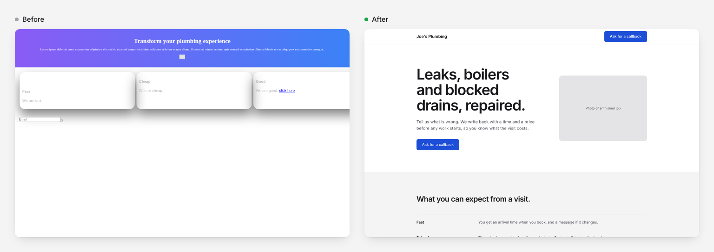

# UI/UX Glowup — Agent Skill

**English** · [Français](README.fr.md)



Audit score of this page, measured with `scripts/audit.mjs`: **27/45 before → 45/45 after** (`tests/fixtures/before.html` and `tests/fixtures/after.html`).

An AI agent skill that upgrades any web interface to the level of the best-designed sites on the web — Linear, Stripe, Vercel, Apple, Airbnb, Mercury and more. Works with Claude Code, OpenAI Codex, Cursor, Windsurf, GitHub Copilot and any agent that supports the [Agent Skills spec](https://agentskills.io).

It **keeps your brand colors** and works on everything else: structure, typography, spacing, components and finishing details. With no brand yet, it proposes a short palette for you to confirm — never a brand identity. Then it **looks at its own output** with desktop and mobile screenshots and fixes what it sees.

**Contributions welcome!** Found a way to improve the skill or have a new example to add? [Open a PR](#contributing).

## What makes it different

- **Starts with a short questionnaire.** From zero or for a redesign: project type (SaaS/tech, portfolio/agency, business showcase, e-commerce, dashboard), goal, **modernity level** (Classic / Modern / Bold), assets, icons, dark mode, charts, must-keep elements, brand choices to keep, SEO phrases. Answers become a brief.
- **Always ends with a "Directions taken" recap.** Style, references and what was borrowed, typography, components, icons, charts/KPIs, mobile fixes, SEO, every text edit before → after, product decisions to confirm.

- **Named references, not vague best practices.** For every job the agent picks 2–3 reference sites from the same category and states exactly what it borrows from each.
- **Tested example code.** 15 complete pages and sections (including a light/dark KPI & chart kit) in Tailwind v4 plus a typed React dashboard. The agent starts from them, so the floor is high.
- **Visual self-check.** A Playwright script captures the result at 1440px and 390px and flags horizontal overflow. The agent reviews, fixes and re-captures.
- **Measured, not eyeballed.** `audit.mjs` checks contrast, touch targets, type scale, spacing grid, headings, labels and more at desktop and mobile, and scores 9 criteria (/45, including SEO) before and after. Nothing ships below 4/5.
- **Catches real phone bugs.** Amounts and button labels that wrap, table columns pushed off-screen, clipped content, crowded taps, inputs that make iOS zoom, blocked zoom, banners covering the screen, sliders without snap or with tiny/unlabeled arrows — and it names root causes (e.g. a 15px root font-size behind hundreds of fractional spacings).
- **Spacing, readability and SEO.** Gaps between blocks and section rhythm, long paragraphs and sentences, justified text, title/description/Open Graph/favicon/canonical/JSON-LD, image format, size and lazy-loading. Copy is clarified for readers — never rewritten to stuff keywords.
- **Readable by crawlers and AI assistants.** The audit loads the page once more with JavaScript off and reports a missing H1, missing text or a missing FAQ; an H1 whose words are glued in the HTML; JSON-LD that does not parse, uses an unknown type, does not match the visible FAQ or carries a rating with no reviews. `audit-site.mjs` adds `robots.txt`, `sitemap.xml`, `llms.txt`, blocked AI crawlers and hreflang.
- **Motion that never hides content.** Text left invisible when the animation does not run (no JS, reduced motion), animated layout properties, layout shift while scrolling, reveals on every section, infinite loops, slow motion and `will-change` everywhere.
- **Honest copy.** Vague calls to action ("Learn more", "En savoir plus"), clichés in English and French, claims with no source ("#1", "+500 clients") and generic error messages are flagged. The skill never invents a figure, a rating or a review.
- **Right register for the sector.** `sectors.md` covers health, public services, finance, real estate, travel, education, fashion, media and more, with a variety check against the default tech look.
- **Brand kept.** `brand-guard.mjs` fails when a change removes a brand color, drops a font or adds a UI library nobody asked for.
- **Every size, every language.** `responsive.mjs` sweeps 14 sizes and stress-tests long words, +50% text and right-to-left; `consistency.mjs` checks that pages look like one site.
- **Reachable, even without a mouse.** Journeys state a goal and a budget of actions and can run with the keyboard alone; `ux.mjs` adds the checks of each kind of site (shop, SaaS, local business, dashboard, article) ranked by impact; `a11y.mjs` operates tabs, accordions, dialogs and menus and tests 200% and 400% zoom.
- **Measured, not just claimed.** `benchmark/` seeds known defects and regressions into ten projects and publishes what is found, what is missed and what is flagged on clean pages (`docs/benchmark.md`, with a before/after gallery).
- **Safe to run.** Backups leave out `.env` and sessions, outputs mask tokens, a pre-commit hook blocks leaked secrets, and `doctor.mjs` says what is missing and how to fix it.
- **Your stack, kept.** `stack.mjs` detects Next, Nuxt, Vue, Svelte, Angular, Astro, WordPress (and its page builder), Tailwind, shadcn, MUI, Bootstrap and says where the tokens live; nothing new is added without asking.
- **Every browser.** `cross-browser.mjs` compares Chromium, Firefox and WebKit; `--browser` works on the other scripts.
- **Fast.** `perf.mjs` measures LCP, CLS, blocking time and weight on a throttled phone, and names the cause: oversized or lazy hero image, blocking scripts, fonts, heavy libraries.
- **Accessible by keyboard.** `a11y.mjs` presses Tab through the page and checks focus, ARIA, skip links and 320 px reflow against WCAG 2.2 AA.
- **Nothing broken.** `smoke.mjs` clicks every safe control, checks forms and JS errors, and `--baseline` flags what a redesign stopped doing.
 `inventory.mjs` lists every element of a page (links, CTAs, forms, images, contacts, legal, trackers, structured data) and `--compare` shows what a redesign lost.
- **Visuals, charts and KPIs.** Guidance for clean 3D, bento with micro-animations, semi-flat, interactive SVG charts (Recharts, Chart.js, Framer Motion), donuts with the key number in the center, KPI cards with sparklines, dark mode for every chart, WebP/AVIF + SVG.
- **Clean PDFs.** Invoices and quotes (French legal mentions incl. the 2026 reform), reports, proposals and one-pagers from print-ready templates. `pdf.mjs` prints, then checks fonts (embedded, no blurry Type 3, no fallback glyphs), blank or near-empty pages, overflow, tiny text, title, page numbers and the mentions each document type needs — and shows every page in one image. `site-fonts.mjs` reuses the website's own fonts, with license hints.
- **Icons and favicons.** `find-icons.mjs` searches 200k+ open icons (Phosphor, Solar, Tabler…) with licenses, plus Flaticon; `make-favicon.mjs` generates every favicon size and the `<head>` snippet.
- **Works on real products.** Audits pages behind a login, whole sites (`audit-site.mjs`), and maps every finding to `file:line` in your codebase (`locate.mjs`) so fixes land in the real components.
- **Real reference values.** `extract-tokens.mjs` measures a reference site's type scale, heading tracking, spacing rhythm, radii and shadows — so "like Linear" means Linear's actual numbers.
- **Anti "AI look".** The audit flags the measurable tells (purple gradients, glass everywhere, giant radii, three identical cards, emoji headings, cliché copy, everything centered); `anti-ai.md` gives the fix for each. A pattern your brand uses on purpose (a pill above the heading, an accent word, uppercase labels) is listed at intake and accepted with `--allow`.

## Light on tokens

- **Three effort levels** — Quick (one fix), Standard (one page), Full (whole site): small requests skip the questionnaire, references and inventory.
- **Loads only what the task needs**: a routing table in `SKILL.md` points to one reference file per need, and examples are read section by section.
- **Compact re-checks**: `audit.mjs --baseline before.json` prints only score changes and open issues (~70% shorter than a full report); `screenshot.mjs --selector ".pricing" --only mobile` captures just the part you changed.
- **The extra page load happens once**: the no-JavaScript render runs on the first audit; re-checks repeat it only if it found something (`--fast` skips it, `--deep` forces it).

## How it works

```
  Intake questionnaire → brief ──► references/intake.md
  (redesign: inventory)          scripts/inventory.mjs
          │
          ▼
  Automated audit + visual review ──► scripts/audit.mjs
          │
          ▼
  Pick 2–3 reference sites ──► references/sites.md
          │                            scripts/extract-tokens.mjs
          │
          ▼
  Rebuild section by section ──► references/sections.md + craft.md
          │                      assets/examples/*.html
          ▼
  Screenshot desktop + mobile ──► scripts/screenshot.mjs
          │        ▲
          └─ fix ──┘
          │
          ▼
  Re-audit (≥ 4/5, no errors) + inventory --compare
          │
          ▼
  Code + before/after image + "Directions taken" recap ──► scripts/compare.mjs
```

## Examples included

| Example | Inspired by | Use for |
|---|---|---|
| `hero-linear.html` | Linear, Attio | SaaS, apps, tools |
| `bento-vercel.html` | Vercel, Apple | Features, services |
| `features-stripe.html` | Stripe | Product explanation, B2B |
| `pricing.html` | Linear, Vercel | Pricing pages |
| `dashboard-shell.html` | Linear, Stripe Dashboard | Back-offices, CRMs, apps |
| `dashboard-dark.html` | Linear app, Stripe, Vercel | Dark, data-dense apps |
| `local-business.html` | Aesop, Mercury, Stripe | Trades, local services, health |
| `product-page.html` | Aesop, Allbirds | E-commerce |
| `kpi-cards.html` | Stripe, Linear, Vercel | KPI cards, donut, goal ring, bars, sparklines — light/dark |
| `article.html` | Stripe Press, Linear Method | Blog, docs, case studies, news |
| `auth.html` | Linear, Vercel, Clerk | Login, sign-up, onboarding step |
| `settings.html` | Linear, Stripe, GitHub | Account, workspace, admin screens |
| `clinic.html` | Zocdoc, One Medical, NHS | Clinics, health practices, care |
| `data-table.html` | GitHub, Stripe, Linear lists | Sober back-office lists: search, filter, sort, bulk actions, empty state |
| `smb-light.html` | Warm light B2B sites | Small-business software, B2B services |
| `react/DashboardShell.tsx` | — | React projects |

PDF templates (`assets/pdf/`): `facture-devis.html` (French invoice/quote), `report.html`, `proposal.html`, `one-pager.html`, `cv.html`, `letter.html`.

## Installation

### Option 1: CLI Install (Recommended)

Use [npx skills](https://github.com/vercel-labs/skills):

```bash
npx skills add tpvn99/ui-ux-glowup
```

The CLI detects which agents you have installed and asks where to install. For Claude Code it installs into `.claude/skills/`; universal agents share `.agents/skills/`.

> [!TIP]
> If you run the command from **inside** an agent session, pass the agent explicitly so it lands where your agent reads it:
>
> ```bash
> npx skills add tpvn99/ui-ux-glowup -a claude-code
> ```

### Option 2: Claude Code Plugin

```bash
/plugin marketplace add tpvn99/ui-ux-glowup
/plugin install ui-ux-glowup
```

### Option 3: Clone and Copy

```bash
git clone https://github.com/tpvn99/ui-ux-glowup.git
cp -r ui-ux-glowup/skills/ui-ux-glowup .agents/skills/     # or ~/.claude/skills/
```

### Option 4: Claude.ai / Claude Desktop

Zip the `skills/ui-ux-glowup` folder and upload it from the Skills section of Claude's settings.

### Recommended: enable the visual check

The checks that open a browser (audit, screenshots, tests) need **Node 20+** and Playwright in the project where the agent works (Node 18 only runs the scripts that need no browser); `node <skill-dir>/scripts/doctor.mjs` tells you what is missing:

```bash
npm i -D playwright && npx playwright install chromium
```

Without it, the skill still works — the agent falls back to a careful code review.

## Usage

Just ask your agent. The skill triggers on requests like:

- "Make this landing page look like Stripe" (attach the file or paste the code)
- "Redesign our admin dashboard, it should feel like Linear"
- "Here's a screenshot of our homepage — it looks amateur, fix it"
- "Build a homepage for a plumber in Leeds: 4.8★ from 212 reviews, 24/7 callouts"
- "Audit the UI of https://example.com and tell me what to improve"
- "The slider is broken on phones and people tap the wrong buttons"
- "Improve SEO and readability of this page without changing our message"
- "Design the KPI section of our dashboard, it must work in dark mode"
- "Find less generic icons and make us a favicon"

It first asks a short questionnaire (skip any question and it uses sensible defaults). You get complete code, a before/after image and a **Directions taken** recap: brief, score before → after, references and what was borrowed, typography, components, icons, charts, mobile and SEO fixes, every text edit, and product decisions to confirm.

## Repository structure

```
skills/ui-ux-glowup/
├── SKILL.md                    # Workflow
├── references/
│   ├── intake.md               # Start-of-job questionnaire, modernity levels, brief
│   ├── sites.md                # Reference sites for SaaS and tech + what to borrow
│   ├── sectors.md              # References by sector (health, finance, real estate, travel…), variety check
│   ├── sections.md             # Patterns by section (hero, features, pricing, dashboard…)
│   ├── craft.md                # Finishing details that make it look professional
│   ├── implement.md            # Code mode: from findings to changes in the real codebase
│   ├── frameworks.md           # Per-stack rules (Next, Nuxt, Svelte, Angular, WordPress, Tailwind, shadcn, MUI…)
│   ├── testing.md              # Smoke test, journeys, other browsers, sizes, consistency
│   ├── ux.md                   # UX audit rules and what a script cannot see
│   ├── a11y.md                 # WCAG 2.2 AA behaviour checks
│   ├── performance.md          # LCP, CLS, weight, images, scripts
│   ├── modes.md                # Audit only / recommend / apply, levels of intervention
│   ├── scripts.md              # Every script and its use
│   ├── visuals.md              # 3D, bento, semi-flat, charts, KPI designs, dark mode, WebP/SVG
│   ├── mobile.md               # Taps, forms, carousels, overlays on phones
│   ├── seo-readability.md      # Section spacing, readability, on-page SEO, GEO, copy rules
│   ├── microcopy.md            # Form errors, confirmations, empty states, 404
│   ├── direction.md            # Plan before building: subject, tokens, colors, one bold place
│   ├── motion.md               # Motion that explains; safe without JS and with reduced motion
│   ├── icons.md                # Icon search, Flaticon, favicons
│   ├── pdf.md                  # PDF workflow, fonts and licenses, checklists per document type
│   ├── anti-ai.md              # Tells of AI-generated design and what to do instead
│   ├── audit.md                # 9-criteria audit grid (/45)
│   └── checklist.md            # Pre-delivery checklist
├── assets/examples/            # Tested examples (Tailwind v4 + React)
├── assets/pdf/                 # Print-ready PDF templates (invoice/quote, report, proposal, one-pager, CV, letter)
├── scripts/
│   ├── audit.mjs               # Automated UI audit (desktop + mobile), scored /45
│   ├── extract-tokens.mjs      # Measure a reference site's design tokens
│   ├── screenshot.mjs          # Desktop + mobile capture with overflow warning
│   ├── compare.mjs             # Before/after side-by-side image (pages or screenshots)
│   ├── audit-site.mjs          # Crawl + audit a whole site, recurring issues, robots/sitemap/llms.txt
│   ├── locate.mjs              # Map findings to file:line in the codebase
│   ├── login.mjs               # Save a logged-in session (--storage-state)
│   ├── inventory.mjs           # Every element of a page; --compare for redesigns
│   ├── find-icons.mjs          # Search open icon sets (Iconify) + Flaticon link
│   ├── pdf.mjs                 # HTML → PDF + checks + page sheet
│   ├── site-fonts.mjs          # Reuse a website's fonts (static files + fonts.css)
│   ├── make-favicon.mjs        # favicon.ico/svg, apple-touch, PWA icons, <head> snippet
│   ├── audit.browser.js        # Paste-in-DevTools audit (generated)
│   ├── build-browser-audit.mjs # Regenerates audit.browser.js
│   ├── verify.mjs              # Snapshot before, check after, classified report (md / html)
│   ├── smoke.mjs, scenario.mjs # Click every safe control; user journeys; regressions vs a saved run
│   ├── ux.mjs, a11y.mjs        # UX audit; WCAG 2.2 AA behaviour (Tab walk, ARIA, reflow)
│   ├── perf.mjs                # LCP, CLS, blocking time, weight on a throttled phone
│   ├── responsive.mjs          # 14 sizes, long text and right-to-left stress
│   ├── consistency.mjs         # Same fonts, nav, buttons, palette across pages
│   ├── cross-browser.mjs       # Chromium, Firefox, WebKit compared
│   ├── brand-guard.mjs         # Brand colors, fonts, UI libraries untouched
│   ├── safeguard.mjs           # Backup, rollback, secrets and session files check
│   ├── stack.mjs               # Detect framework, styling, token files, WordPress builders
│   └── lib/                    # Browser loader, color math, page probe, analysis rules, site files, locate, report
└── evals/evals.json            # Test prompts with assertions
```

## Documentation

- [Getting started](docs/getting-started.md): install, first audit, first improvement
- [By type of project](docs/by-project-type.md): landing page, app, shop, WordPress, article, back-office, PDF
- [Levels, modes and limits](docs/levels-and-limits.md): audit only / recommend / apply, light to complete, what is supported, known limits
- [Tutorials](docs/tutorials.md): three walk-throughs to run in this repository
- [Example report](docs/example-report.md): a real before/after report
- [FAQ](docs/faq.md) · [Troubleshooting](docs/troubleshooting.md) · [Installing for each agent](docs/install-by-agent.md)
- [Benchmark](docs/benchmark.md): what the tools find and miss on ten projects with known defects
- [Real device checklist](docs/real-device-checklist.md): what only a real phone or screen reader shows
- [Tested environments](docs/tested-environments.md): what has been run, on what, and what has not
- [Known false positives](docs/known-false-positives.md): findings that are true but may not apply, and measurements that vary

## Using the scripts directly

They're useful on their own, with or without an agent:

```bash
npm i -D playwright && npx playwright install chromium

node skills/ui-ux-glowup/scripts/audit.mjs https://your-site.com
node skills/ui-ux-glowup/scripts/verify.mjs report https://your-site.com --out report.html    # everything, read-only
node skills/ui-ux-glowup/scripts/verify.mjs snapshot page.html --dir .glowup/before          # before the change
node skills/ui-ux-glowup/scripts/verify.mjs check page.html --dir .glowup/before --out report.md   # after
node skills/ui-ux-glowup/scripts/audit.mjs https://your-site.com --allow ai-hero-pill,ai-caps-label   # brand choices
node skills/ui-ux-glowup/scripts/extract-tokens.mjs https://stripe.com
node skills/ui-ux-glowup/scripts/compare.mjs old.png new.html compare.png
node skills/ui-ux-glowup/scripts/audit-site.mjs https://your-site.com --max 15
node skills/ui-ux-glowup/scripts/inventory.mjs https://your-site.com --json before.json
node skills/ui-ux-glowup/scripts/inventory.mjs before.json --compare new-page.html
node skills/ui-ux-glowup/scripts/find-icons.mjs "delivery truck" --sets ph,solar,tabler --download icons/
node skills/ui-ux-glowup/scripts/make-favicon.mjs logo.svg public/ --bg "#1f4d3a"
node skills/ui-ux-glowup/scripts/site-fonts.mjs https://your-site.com docs/ --static
node skills/ui-ux-glowup/scripts/pdf.mjs docs/invoice.html --type invoice      # needs poppler for the page sheet

# Behind a login
node skills/ui-ux-glowup/scripts/login.mjs https://app.your-site.com      # log in, press Enter
node skills/ui-ux-glowup/scripts/audit.mjs https://app.your-site.com/dashboard --storage-state state.json --json audit.json
node skills/ui-ux-glowup/scripts/locate.mjs audit.json src                # file:line for each finding
```

Or paste `skills/ui-ux-glowup/scripts/audit.browser.js` into the DevTools console of any tab.

Example audit output:

```
Audit: Hierarchy 5 · Typography 4 · Spacing 3.5 · Components 4.5 · Visuals* 4 · Content* 3.5 · Responsive 1.5 · A11y 4 · SEO 4 → 34/45
✗ [Accessibility] The viewport meta blocks pinch-zoom (user-scalable=no / maximum-scale=1); remove it.
✗ [Responsive] Fixed/sticky elements cover a large part of the mobile screen.
    body > div.banner covers 49% (fixed)
! [Components] Swipe areas without scroll-snap stop between slides.
    section > div.track (4 items)
! [Visuals] Row of 3–4 identical icon + title + text cards — the default AI layout.
```

## Development

```bash
npm install && npx playwright install chromium
npm test              # unit tests + browser integration tests
./validate-skills.sh  # skill spec + manifests
```

## Contributing

New example, better reference, a pattern the skill misses? See [CONTRIBUTING.md](CONTRIBUTING.md). Run `./validate-skills.sh` and re-capture any example you touch before opening a PR.

## License

[MIT](LICENSE)
