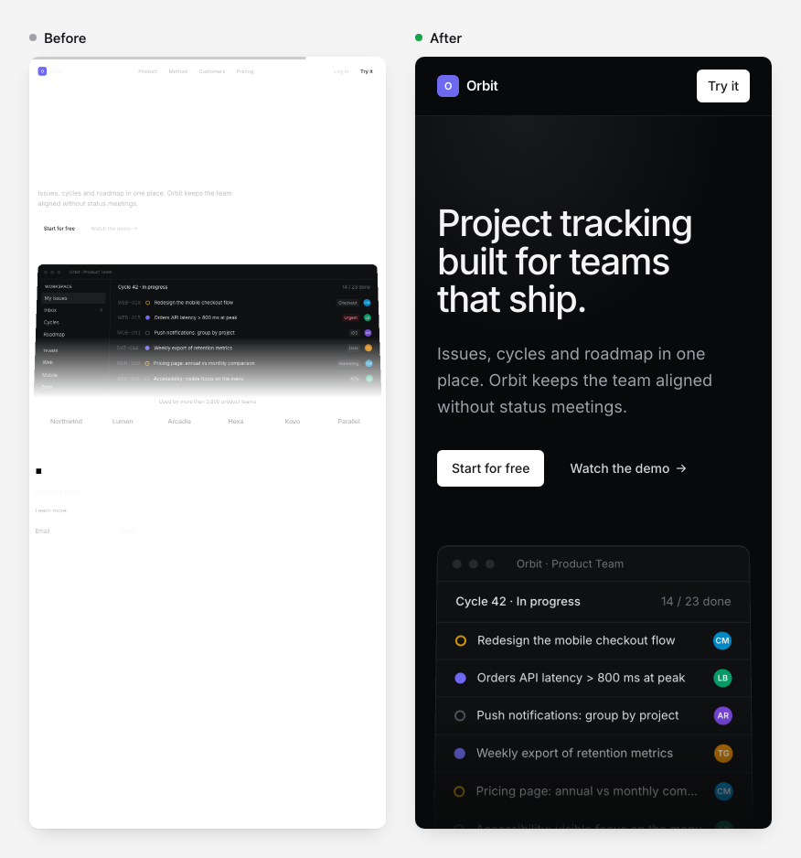
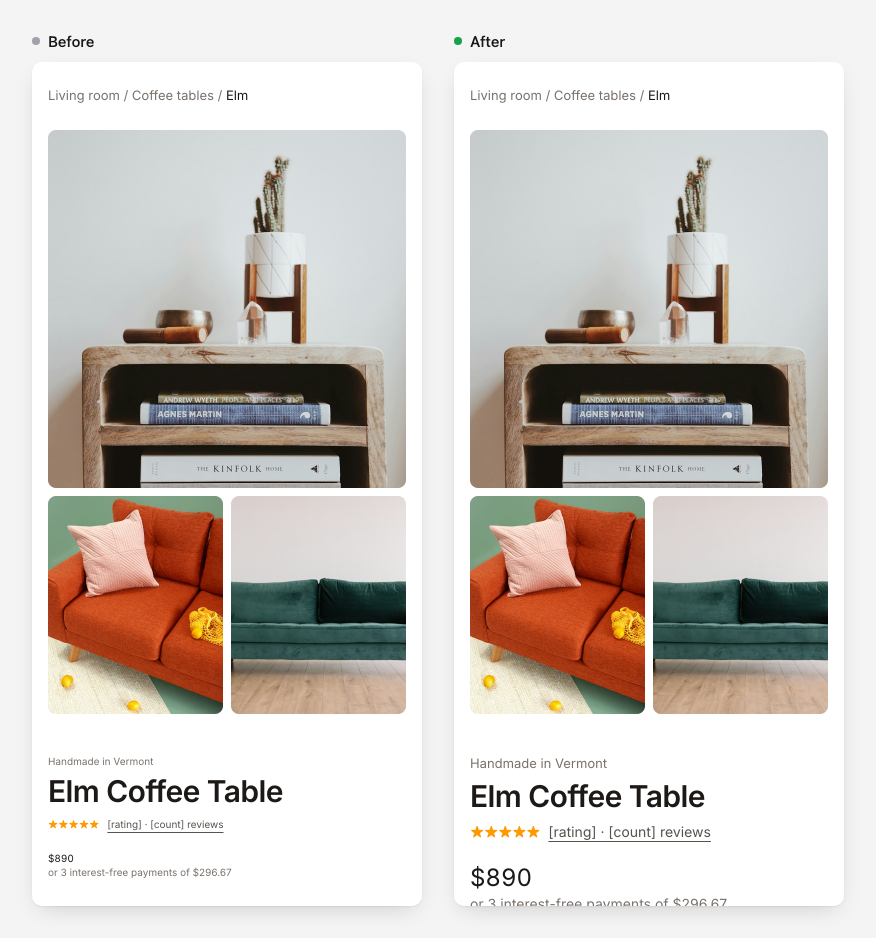
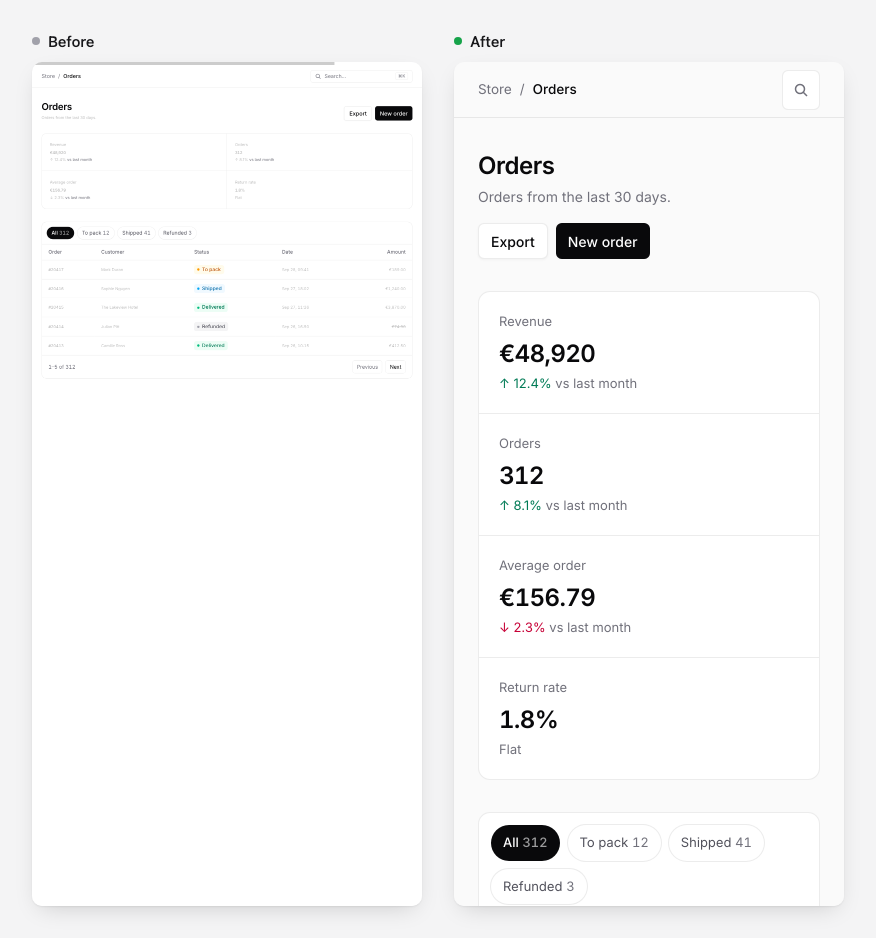
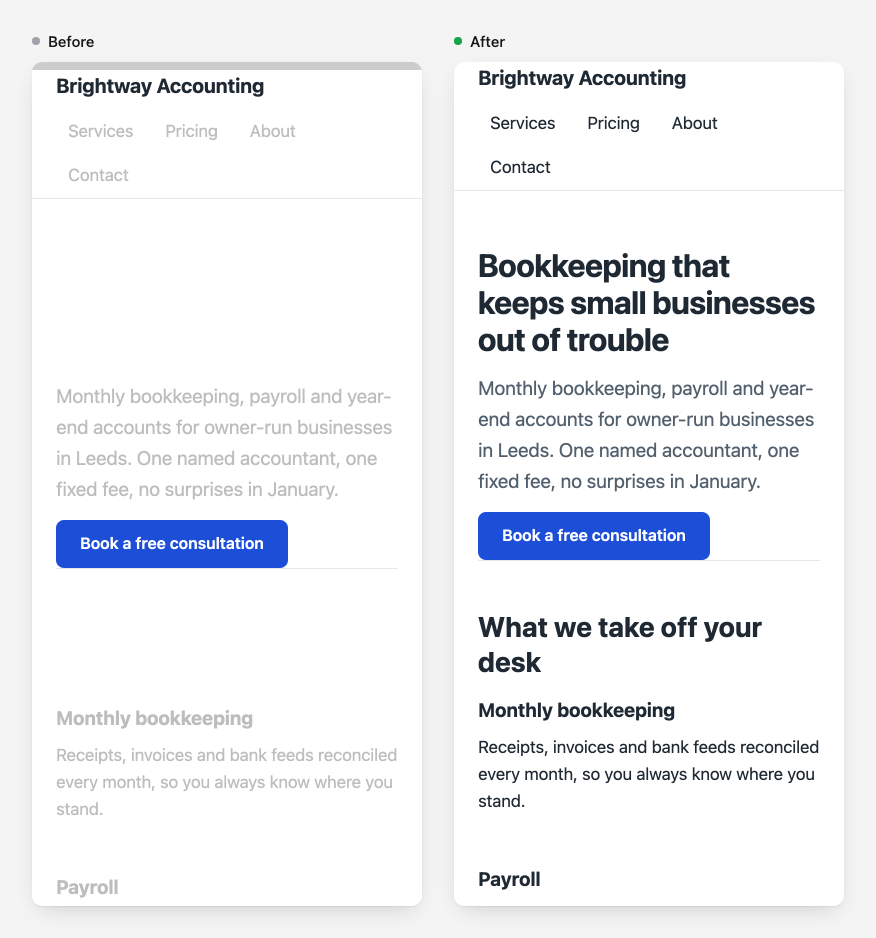
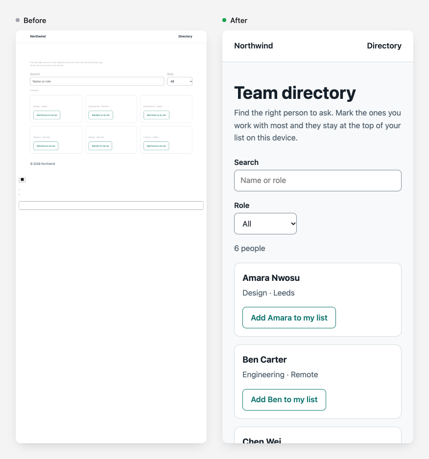
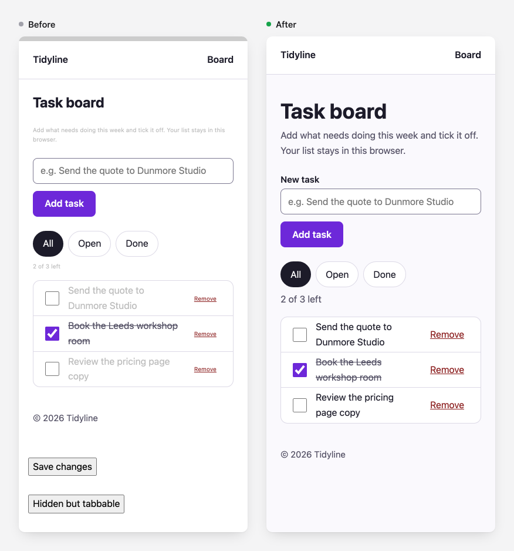
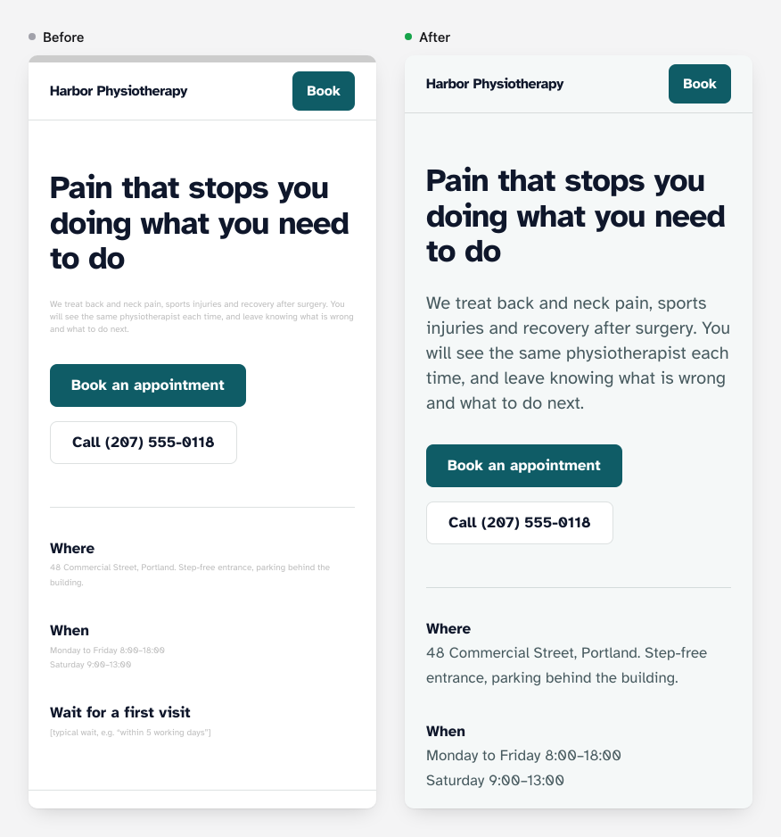
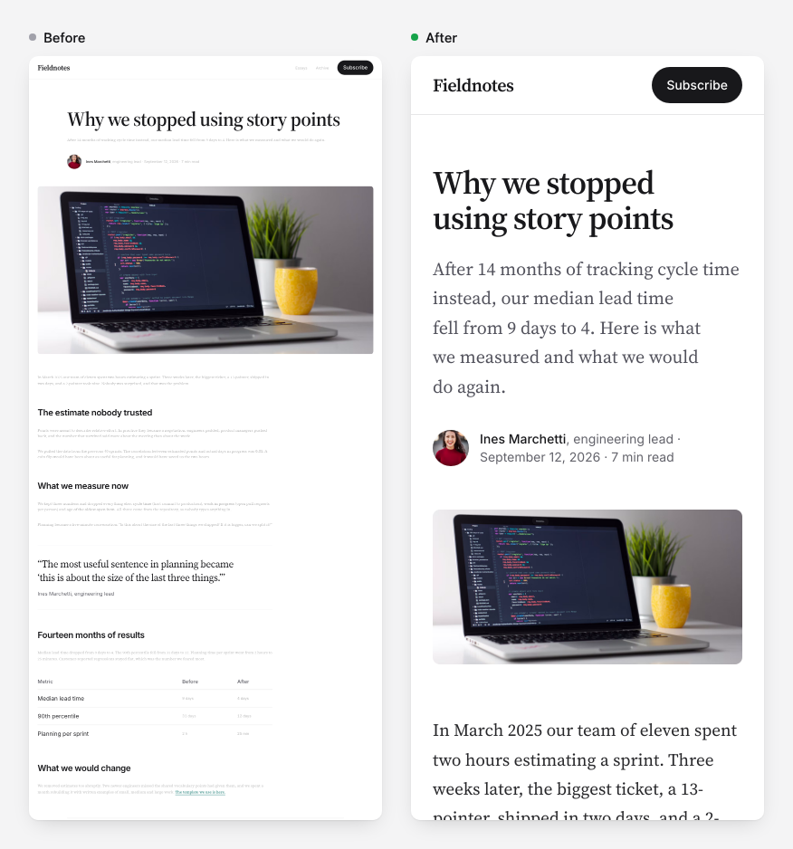
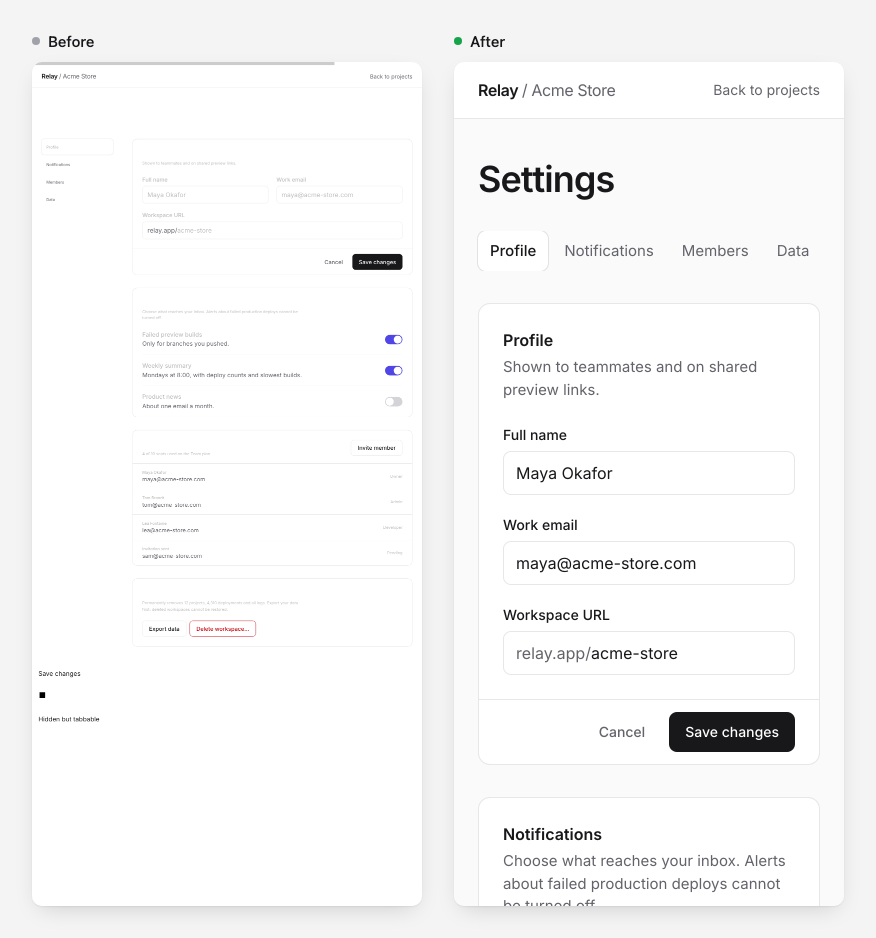
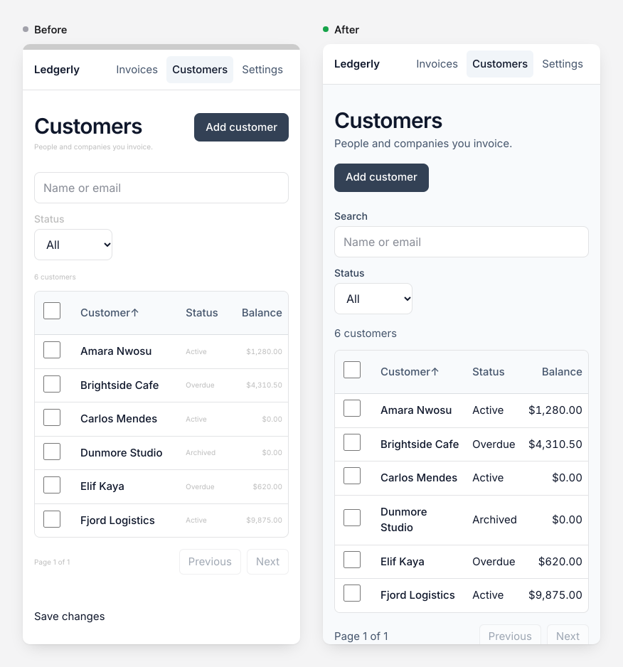

# Gallery: what the defects do to a page

Ten projects at phone width. **Before** is the clean page with its seeded defects, **after** is the clean page. This shows what the checks were looking for; it is not a redesign. Defects are listed with the check that reported each (all found in the final run).

| Project | Before and after | Seeded defects |
|---|---|---|
| SaaS landing |  | no viewport tag, no `lang`, no `<title>`, no H1, grey text, focus outline removed, 760px block, blocking script, script error, unnamed icon button, `div` used as a button, empty link, heading hidden until an animation runs, form that cannot show errors |
| Shop |  | no description, pinch zoom blocked, 10px text, image without alt, lazy-loaded first image, `tabindex="3"`, button inside `aria-hidden`, broken image, duplicate id, no `<main>`, `noindex`, stretched image |
| Dashboard |  | no viewport tag, grey text, focus outline removed, keyboard trap, button with no behaviour, unnamed icon button, 10px text, overflow, placeholder text, empty link, no H1, button inside `aria-hidden`, form that cannot show errors |
| WordPress-style site |  | field without label, image without alt, no `lang`, no title, no description, zoom blocked, blocking script, no `<main>`, grey text, overflow, `div` as a button, empty link, stretched image, heading hidden until an animation runs |
| React app |  | search field without label, no viewport tag, no title, 10px text, grey text, focus removed, blocking script, unnamed icon button, duplicate id, keyboard trap, script error, no `<main>`, heading hidden until an animation runs |
| Vue app |  | field without label, no H1, no `lang`, zoom blocked, 10px text, grey text, dead button, `tabindex="3"`, `aria-hidden` button, overflow, blocking script, empty link, form that cannot show errors |
| Institutional |  | no description, no title, no `lang`, no H1, grey text, focus removed, 10px text, overflow, script error, `div` as a button, unnamed icon button, `noindex`, stretched image |
| Editorial |  | no viewport tag, zoom blocked, no H1, image without alt, grey text, 10px text, placeholder text, empty link, duplicate id, broken image, blocking script, no `<main>`, stretched image, form that cannot show errors |
| Responsive app screen |  | field without label, overflow, 10px text, grey text, focus removed, dead button, unnamed icon button, `tabindex="3"`, `aria-hidden` button, keyboard trap, no viewport tag, no `lang`, heading hidden until an animation runs |
| App with several journeys |  | field without label, dead button, keyboard trap, overflow, grey text, focus removed, 10px text, unnamed icon button, `aria-hidden` button, duplicate id, script error, no title, stretched image |

Regenerate with `node benchmark/gallery.mjs`. Pages that load Tailwind or fonts need network access when captured.
